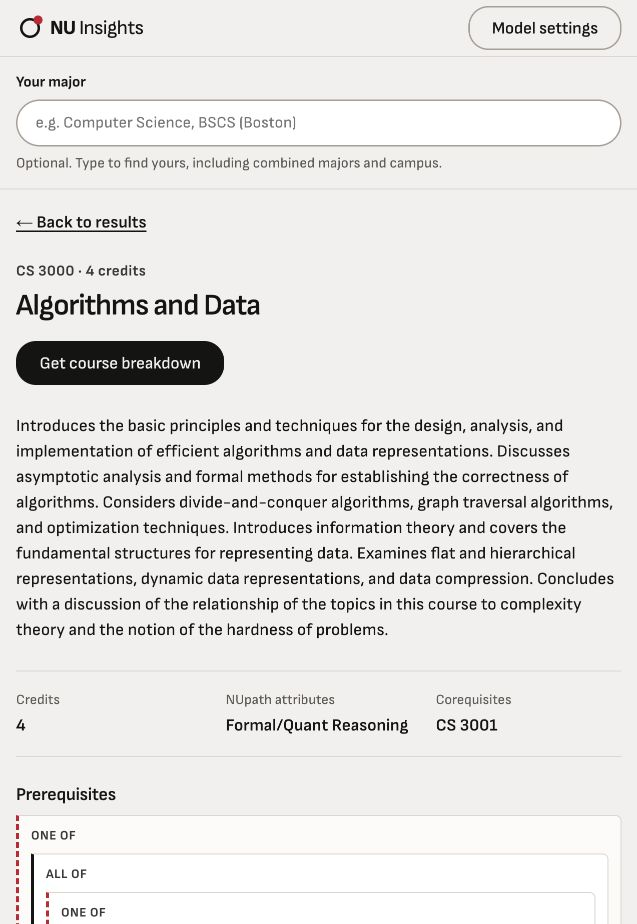
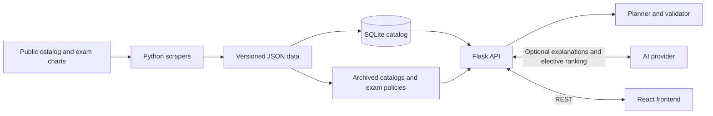

<div align="center">

# NU Insights

Course search and semester planning for Northeastern students.

**[Try the live app](https://nuinsights.josephkelly.dev)**


[Features](#features) · [Run locally](#run-locally) · [Deployment](#deployment) · [How it works](#how-it-works) · [Tests](#tests)

</div>

NU Insights lets you look up courses, check degree requirements, and plan semesters around co-op and graduation. No account needed. Plans save in your browser and can be exported as JSON or printed.

Course search and planning work without AI. Optional AI features explain courses and suggest electives based on your interests. Prerequisite and requirement checks use catalog rules and a constraint solver.

<details>
<summary>Course browser preview</summary>



</details>

## Features

- **Course search.** Search 6,034 courses by code or title. See descriptions, credits, prerequisites, corequisites, and NUpath attributes.
- **Degree requirements.** Browse majors and concentrations using your catalog year, from 2022-2023 through 2026-2027.
- **Semester planning.** Add completed courses, pin future choices, set credit targets, and mark co-op or terms off. Review generated suggestions before adding them to your plan.
- **AP and IB credit.** Look up published exam equivalents. Estimated credit stays separate from awarded credit.
- **Course explanations.** Use free default models or your own OpenAI, Anthropic, Gemini, or OpenRouter key.
- **Saved drafts.** Keep separate plans by major, catalog year, and concentration. Import, export, or print them.

### Coverage and limits

The checked-in data was collected on October 13, 2026. It includes 162 course subjects, 395 current bachelor program variants, and archived requirements for the previous four catalog years. AP/IB policies cover 2026-2027. Sample plans come from 2025-2026 and do not confirm future course offerings.

Boston BSCS with the Artificial Intelligence concentration for 2026-2027 is the reviewed planning pilot. Other programs may contain requirements that still need review. The planner checks modeled requirements, but it cannot confirm graduation eligibility, approvals, GPA rules, or actual semester offerings. CPS, minors, double majors, and graduate degree planning are outside the current scope.

See [catalog coverage and review notes](docs/DATA.md) for details.

## Run locally

Requires Python 3.10+ and Node.js 18+. Course data is included in the repository.

```sh
git clone https://github.com/joseph-kelly1/nu-insights.git
cd nu-insights

python3 -m venv .venv
source .venv/bin/activate
pip install -r requirements.txt
python3 -m backend.db_loader

cd frontend
npm ci
npm start
```

Open [localhost:3000](http://localhost:3000). `npm start` runs React and the Flask API together. Keep the virtual environment active so it uses the installed Python dependencies. React forwards `/api` requests to port 8000.

To enable default AI locally, create `.env` in the repository root:

```dotenv
OPENROUTER_API_KEY=your-openrouter-key
```

You can also enter your own provider key in **Model settings**. Browsing, plan checking, and generation without AI do not need a key.

## Deployment

The live app runs in one Railway service at [nuinsights.josephkelly.dev](https://nuinsights.josephkelly.dev). Gunicorn serves the Flask API and the built React frontend. Railway manages HTTPS, and Cloudflare manages DNS.

The Docker build creates the catalog database from the repository's data files. Default AI credentials are stored in Railway environment variables. User drafts stay in browser storage.

Deploy from a checkout linked to the `nu-insights` service:

```sh
railway up --service nu-insights
```

GitHub automatic deployments are not connected. See [deployment instructions](docs/DEPLOYMENT.md) for project linking, infrastructure settings, and domain maintenance.

## How it works



The loader builds SQLite from the current course and requirement snapshots. Archived catalogs and exam policies load directly from JSON. Original course codes, source links, alternatives, and lecture/lab bundles are kept in the data.

OR-Tools CP-SAT schedules remaining courses around prerequisites and credit limits. It preserves completed courses, pinned choices, co-op, and skipped terms. A separate validator checks each proposal before the UI offers it for review. If AI elective ranking fails, generation can continue without those preferences.

| Part | Stack |
| --- | --- |
| Frontend | React 19, CSS, react-markdown |
| Backend | Python, Flask, SQLite |
| Planner | OR-Tools CP-SAT |
| AI | OpenAI SDK for OpenRouter, HTTPX adapters for custom providers |
| Data collection | requests, BeautifulSoup, pdfplumber |
| Hosting | Railway, Docker, Gunicorn, Cloudflare DNS |
| Tests | unittest, Jest, React Testing Library |

<details>
<summary>Repository layout</summary>

```text
backend/              Flask API, planner, catalog loader, and provider adapters
frontend/             React app and component tests
json_scrapers/        Course, requirement, sample-plan, and exam importers
data/                 Current and archived catalog snapshots
tests/                Backend and data tests
docs/                 API, data, AI, design, and deployment notes
.railway/railway.ts    Railway infrastructure settings
Dockerfile            Frontend build and Python production image
gunicorn.conf.py      Production server settings
var/                  Generated SQLite database, ignored by Git
```

</details>

## AI and privacy

The hosted app has a free default AI mode through OpenRouter. Default requests enforce a $0 price limit. You can use your own provider key and model instead; those requests are billed to your provider account.

Custom keys stay in page memory and pass through the backend to the selected provider. They are not stored, logged, or included in plan exports. Reloading clears the key. Course explanations send course and major context; elective ranking sends interests and candidate course details.

See [AI settings](docs/AI.md) for provider behavior, model settings, and environment variables.

## Tests

With the Python virtual environment active, run from the repository root:

```sh
python3 -m unittest -v
```

Run frontend tests and a production build from `frontend/`:

```sh
CI=true npm test -- --watchAll=false
npm run build
```

Backend tests use temporary databases and mock AI requests. They do not need an API key or a running server. Tests cover prerequisite order, requirement allocation, archived catalogs, AP/IB credit, planner proposals, and frontend review flows.

To run just the development API, use `python3 -m backend.advisor`. Set `FLASK_DEBUG=1` only for local debugging.

## Documentation

- [API reference](docs/API.md)
- [Catalog coverage and data maintenance](docs/DATA.md)
- [AI settings and privacy](docs/AI.md)
- [Deployment](docs/DEPLOYMENT.md)
- [Interface design](docs/DESIGN.md)

---

Not affiliated with or endorsed by Northeastern University. Data comes from the public [academic catalog](https://catalog.northeastern.edu/) and published AP/IB policies. Confirm requirements and registration decisions with Northeastern advising.
