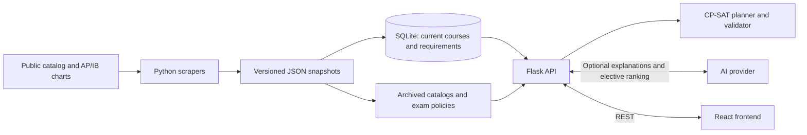

<div align="center">

# NU Insights

**Explore Northeastern courses. Understand your requirements. Build a semester plan.**


[Quick start](#quick-start) · [Features](#features) · [Architecture](#architecture) · [Data coverage](#data-coverage) · [API](#api) · [Tests](#tests)

</div>

---

NU Insights brings course descriptions, prerequisites, degree requirements, and published sample plans into one workspace. Students can browse courses, request plain-English explanations, and build a timeline around completed courses, co-op, and graduation goals.

Course Builder uses a constraint solver to suggest remaining courses and check the result. AI can explain courses and rank electives by interest; academic checks run independently of the model. Browsing and planning without AI work without an API key.

## Quick start

Requires **Python 3.10+** and **Node.js 18+**. Checked-in data is included; no scraping is needed to run locally.

```sh
git clone https://github.com/joseph-kelly1/nu-insights.git
cd nu-insights

python3 -m venv .venv
source .venv/bin/activate
pip install -r requirements.txt
python3 -m backend.db_loader

cd frontend
npm ci
npm start
```

Open [localhost:3000](http://localhost:3000). The development server proxies API requests to Flask on port 8000. Keep the virtual environment active: `npm start` runs the backend with `python3` from your `PATH`.

For AI features, either enter your own key in **Model settings**, or create a `.env` file in the repository root before starting the app:

```dotenv
OPENROUTER_API_KEY=your-openrouter-key
```

An [OpenRouter key](https://openrouter.ai/keys) enables the app's free default models. Without it, course browsing, plan checking, deterministic generation, and custom provider keys remain available.

## Features

- **Course search:** browse 6,034 courses across 162 subjects in the checked-in 2026–2027 snapshot. Search by code or title, then inspect credits, prerequisite AND/OR trees, corequisites, and NUpath attributes.
- **Major and concentration browsing:** explore published requirement sections, with course bundles and alternatives kept together. Select campus-specific concentration options and see their source requirements.
- **Course explanations:** request a summary, skills, career relevance, and historical sample-plan context grounded in the selected course and major.
- **Semester planning:** record completed and current courses, pin future courses, set credit targets, and mark co-op or skipped terms. Generate a proposal, inspect its changes, then apply or discard it.
- **Catalog-year selection:** use requirements from 2022–2023 through 2026–2027, with the concentration choices and historical course data for that edition.
- **AP/IB credit:** select an exam, score, and IB level to preview published Northeastern equivalents. Estimates remain separate from awarded credit; shared equivalents count once.
- **Flexible AI providers:** use free OpenRouter routing or your own OpenAI, Anthropic, Gemini, or OpenRouter key. Model discovery is live; custom model IDs are also supported.
- **Local drafts:** plans save in the browser, separately by major, catalog year, and concentration selection. Export/import JSON or print a plan. API keys are excluded from saved plans.

## Architecture



The data pipeline preserves original course codes, sources, catalog years, AND/OR choices, and lecture/lab bundles. A loader builds the current SQLite database; archived requirements and exam policies load from their versioned JSON snapshots.

The planner treats completed/current courses, pinned entries, fixed terms, co-op, and skipped terms as protected commitments. OR-Tools CP-SAT places courses in open future terms, respects prerequisite order and credit caps, and allocates courses to modeled requirements. Each proposal is independently rechecked before the frontend offers it for review. Elective pools can remain labeled placeholders when no specific course is selected.

AI ranking is optional. The server validates candidate codes, uses structured output on supported models, and normalizes safe formatting locally. If ranking is malformed, cut off, refused, rate-limited, or times out, generation continues without AI preferences and shows one short explanation. Key, billing, access, and model errors remain actionable. The app does not retry a completed malformed ranking or switch a custom request to another model or credential source. Provider thinking-setting negotiation may repeat requests after rejected parameter settings.

Interface conventions are documented in [docs/DESIGN.md](docs/DESIGN.md).

### Stack

| Layer | Tools |
| --- | --- |
| Frontend | React 19, plain CSS, Sofia Sans, react-markdown |
| API | Python, Flask, SQLite |
| Planning | OR-Tools CP-SAT and an independent allocation check |
| AI | OpenAI SDK for default OpenRouter routing; HTTPX adapters for custom providers |
| Extraction | requests, BeautifulSoup, pdfplumber |
| Tests | Python unittest, React Testing Library, Jest |

### Project structure

```text
├── backend/                   # Python API and planning package
│   ├── advisor.py             # Flask routes and default AI routing
│   ├── ai_providers.py        # Custom keys, model discovery, provider adapters
│   ├── planner.py             # Plan validation, scheduling, elective ranking
│   ├── planner_rules.py       # Requirement compilation and reviewed profiles
│   ├── catalog_editions.py    # Archived requirements and concentrations
│   ├── course_replacements.py # Scoped replacement registry and resolver
│   ├── exam_credit.py         # AP/IB policies and awarded-credit resolution
│   ├── db_loader.py           # JSON → SQLite loader
│   └── paths.py               # Shared repository and runtime paths
├── tests/                     # Offline backend and data-pipeline tests
├── frontend/                  # React workspace and component tests
├── json_scrapers/             # Catalog, archive, and exam importers
├── data/
│   ├── courses/               # Current course descriptions
│   ├── plans/                 # Versioned sample plans
│   ├── requirements/          # Current requirement snapshots
│   ├── catalogs/              # Archived catalogs and courses
│   ├── exams/                 # Versioned AP/IB policies
│   └── course_replacements.json
├── docs/DESIGN.md              # Interface design guidance
├── var/                       # Generated database (ignored by Git)
├── requirements.txt           # Python dependencies
└── README.md
```

## Data coverage

Coverage reflects the checked-in snapshots collected on **October 13, 2026**.

| Dataset | Coverage |
| --- | --- |
| Current courses | 2026–2027: 6,034 courses across 162 subjects |
| Current undergraduate requirements | 2026–2027: 395 bachelor program variants, 22 concentration pages, and 2 shared requirement documents |
| Archived requirements | 2022–2023 through 2025–2026, including edition-specific concentrations and course descriptions |
| Active sample plans | Historical 2025–2026 plans; the checked 2026–2027 edition had no published sample-plan grids |
| AP/IB policies | 2026–2027 only; saved exams pin their policy version independently of the degree catalog |
| Intro-course replacements | Three candidate lecture/lab mappings for Boston BSCS catalogs from 2022–2023 through 2024–2025 |

Current concentrations include 739 program-specific options across 99 program variants. These are eligibility records, including repeated concentrations and elective alternatives, rather than 739 distinct concentrations.

### Requirement review and limitations

Boston **BSCS + Artificial Intelligence concentration, 2026–2027** is the reviewed pilot, together with current NUpath and universitywide rules. Other collected programs and archived editions are labeled as automatically extracted unless their exact source content has been reviewed. Ambiguous requirements remain visible as review items rather than guessed rules.

The app reports **all modeled requirements covered**, not graduation clearance. GPA, some hours-in-major and writing/capstone restrictions, approvals, and complex prose policies still require review. Sample plans provide historical timing hints; actual semester offerings are unverified. CPS, minors, double-major combinations, and graduate degree planning are outside current coverage.

Retired courses remain available for past records, with their archived metadata. Future schedules use current prerequisites and course data. Only registry entries marked `verified` automatically fulfill an older requirement; the checked-in Fundies/OOD mappings are currently **candidates**, pending confirmation of older-catalog applicability and lab fulfillment. Students with approval can record it through **Counts as another course?**. Original course identities and actual credits are preserved.

## AI settings and privacy

Open **Model settings → Use my API key**, choose a provider, enter a key, and select a model. Discovery shows the 10 newest eligible flagship models first, then the full supported list. OpenRouter's public model list loads without a key. Listing a model does not verify your account's access or billing.

Keys stay in page memory and travel through this app's backend to the selected provider. They are not stored, logged, exported, or replaced with the server's key. Reloading clears the key; non-secret provider/model preferences can persist. Custom requests are billed to your provider account.

The default route enforces $0 price limits. Custom requests ask for the cheapest thinking setting supported by the model. Ranking requests send interests and candidate course details; course explanations send the selected course and relevant major/concentration context.

<details>
<summary><b>Default AI configuration</b></summary>

Set these in the root `.env` file:

| Variable | Default | Purpose |
| --- | --- | --- |
| `OPENROUTER_API_KEY` | none | Enables the free default AI mode |
| `OPENROUTER_MODEL` | `google/gemma-4-31b-it:free` | Primary model |
| `OPENROUTER_FALLBACK_MODELS` | `openrouter/free` | Comma-separated default routing fallbacks; empty disables them |
| `OPENROUTER_REASONING_ENABLED` | `false` | Whether default requests enable reasoning |
| `OPENROUTER_MAX_TOKENS` | `2048` | Default output-token cap |
| `OPENROUTER_TIMEOUT_SECONDS` | `35` | SDK network timeout, not a total request deadline |

Custom-provider requests use separate limits in `ai_providers.py`: 16,000 output tokens, a 120-second network timeout, and 15 seconds for model discovery. Provider rate limits depend on the selected account and model.

</details>

## Data maintenance

The checked-in snapshots are sufficient for local startup. `var/courses.db` is generated and ignored by Git; rebuild it after changes to current courses, requirements, or sample-plan data. Archived catalogs and exam policies load directly without a database rebuild. The API and loader use repository-relative absolute paths, so data lookup does not depend on the shell’s working directory.

For an existing checkout with a root-level `courses.db`, move it into `var/` before starting the updated API, or rebuild with `python3 -m backend.db_loader`:

```sh
mkdir -p var
mv courses.db var/courses.db
```

<details>
<summary><b>Refresh courses and sample plans</b></summary>

With the virtual environment active, run from the repository root:

```sh
python json_scrapers/department_scraper.py
python json_scrapers/course_scraper.py
python json_scrapers/plan_scraper.py --catalog-year 2025-2026
python -m backend.db_loader
```

The plan scraper retains the active manifest's edition by default. Use `--current-catalog` to select the live catalog, or `--catalog-year` for an explicit edition. `--output-dir` selects a separate data root and `--delay` controls request pacing.

`data/plan_catalog.json` selects active files and records programs with no published plan. Entries preserve alternatives, bundles, electives, co-op, credits, and source text. Fetch/edition/parsing failures leave the active manifest unchanged. The live 2026–2027 scrape collected zero schedules; switching to it will not silently reuse older plans.

Refreshing current courses also records raw prerequisite text, minimum grades, and exact credit options missing from the older checked-in course-description extraction. Until present, variable-credit choices may be flagged as unverified.

</details>

<details>
<summary><b>Refresh current requirements and concentrations</b></summary>

```sh
python json_scrapers/requirements_scraper.py --catalog-year 2026-2027
python -m backend.db_loader
```

The requirements scraper follows the public sitemap and collects undergraduate bachelor requirements, linked concentrations, universitywide rules, and general-education tabs. It checks robots.txt, paces requests, and preserves ordered sections, source wording, AND/OR structure, credit ranges, elective filters, exclusions, and footnotes. Unsupported tables and ambiguous instructions remain marked for review.

Successful runs publish immutable `data/requirements/<year>/<generation>/` snapshots selected by `data/requirements_catalog.json`. Failures leave the active manifest unchanged; the scrape report records coverage and gaps. The concentration export is derived from requirements, and the database loader reads the active requirement snapshot.

To regenerate only the concentration export from existing data:

```sh
python json_scrapers/concentration_scraper.py
python -m backend.db_loader
```

Extraction is not policy validation. Six references absent from the older local course dataset and an unresolved Family Business concentration link were recorded in the October 13 scrape report.

</details>

<details>
<summary><b>Import archived catalogs and AP/IB policies</b></summary>

```sh
python json_scrapers/archive_requirements_scraper.py --years 2022-2023 2023-2024 2024-2025 2025-2026
python json_scrapers/exam_scraper.py
```

The archive importer follows links within explicitly selected editions, caches public HTML, and publishes complete snapshots under `data/catalogs/<year>/`. Archived degree rules never replace current browsing data or silently become a newer degree catalog.

The exam scraper discovers public AP/IB charts and extracts their PDF tables with pdfplumber. It preserves raw rows, source pages, PDF hashes, and policy versions in `data/exams/`. Ambiguous credit splits or changed score/cap policies stop publication. Older saved versions remain available.

Awarded exam records are resolved again by the backend; estimates do not satisfy requirements or prerequisites. Equivalent course bundles retain their component credits and published NUpath attributes, overlap is counted once, and the combined award is capped at 32 credits. A different admission year requires its own published policy snapshot.

</details>

## API

The React development server proxies `/api` to `http://localhost:8000`. POST responses use `Cache-Control: no-store`. Errors generally return `{"error": "...", "code": "..."}`; exam-policy validation errors currently return an `error` message without a code.

<details>
<summary><b>Endpoints and request options</b></summary>

| Endpoint | Purpose |
| --- | --- |
| `GET /api/search?q=` | Search by code/title. Optional `catalog_year` selects archived course data. |
| `GET /api/course/<dept>/<number>` | Course details and companion courses. Optional `catalog_year` selects a historical record. |
| `GET /api/programs` | Program IDs, labels, campus/degree metadata, and sample-plan availability. |
| `GET /api/programs/<id>/courses?q=&offset=` | Current requirement courses, 20 per page. `view=sections` returns unpaginated sections with preserved alternatives; `concentrations=<id>,<id>` selects concentration blocks. |
| `GET /api/programs/<id>/concentrations` | Concentration options and selection policy. Optional `catalog_year` selects an archived edition. |
| `GET /api/programs/<id>/planning-context?catalog_year=` | Planner capability, requirements, sources, sample plans, and replacement summaries. Optional comma-separated `concentrations` selects options. |
| `POST /api/planner/validate` | Check `{"plan": {...}}` against its selected catalog. Optional `dataset` rejects stale data. |
| `POST /api/planner/generate` | Send `{"plan": {...}, "mode": "ai"}` or `"mode": "deterministic"`. Returns a checked proposal/diff and ranking outcome. Optional `dataset` and `ai` configuration. |
| `POST /api/planner/identify` | Send `program_id`, `phrases` (1–15 course names), optional `term`, and optional `ai` configuration. Returns candidate matches for review. |
| `POST /api/analyze` | Send `dept`, `number`, optional `major`, optional `concentrations`, and optional `ai` configuration for a course explanation. |
| `POST /api/ai/models` | Send `provider` and `api_key` for model discovery. OpenRouter needs only `provider`. |
| `GET /api/exams/catalog` | Exam subjects and published policy snapshots. Optional `policy_year` and `version`. |
| `POST /api/exams/resolve` | Send `{"exams": [...]}` to validate scores/levels and resolve equivalent course awards. |
| `GET /api/health` | Server status, default model, and whether default AI is configured. |

Custom AI configuration for supported POST routes:

```json
{
  "ai": {
    "mode": "custom",
    "provider": "openai",
    "api_key": "your-key",
    "model": "your-model-id"
  }
}
```

Providers are `openai`, `anthropic`, `gemini`, and `openrouter`. Omit `ai` to use the default route. Plan exports from the UI provide the plan structure; custom keys are never part of those exports.

</details>

## Tests

With the virtual environment active, from the repository root:

```sh
python3 -m unittest -v
```

From `frontend/`:

```sh
CI=true npm test -- --watchAll=false
npm run build
```

Backend tests mock provider requests and use temporary databases; they need no AI key, network, or prebuilt `var/courses.db`. Coverage includes prerequisite ordering, requirement allocation, historical catalogs, replacement scope, AP/IB overlap, ranking recovery, protected records, and frontend review/apply behavior.

To run only the API during development, use `python3 -m backend.advisor`. `FLASK_DEBUG=1` enables Flask's development reloader/debugger; keep it off in production. A hosted deployment needs the built React frontend and a production Python server serving `backend.advisor:app`, with HTTPS for requests carrying user keys.

---

<sub>Not affiliated with or endorsed by Northeastern University. Sources: the public <a href="https://catalog.northeastern.edu/">Northeastern academic catalog</a> and published AP/IB policies. This is a planning aid, not an official degree audit. Confirm requirements and registration decisions with Northeastern advising.</sub>
