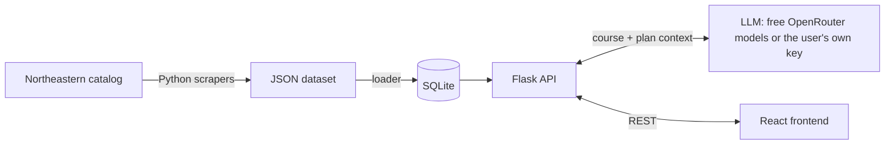

<div align="center">

# NEU Insights: AI Course Advisor

**Plain-English, student-focused breakdowns of every Northeastern University course.**


**Live demo: coming soon**

</div>

---

## The problem

Northeastern's course catalog tells you a course's title, credits, and a dry paragraph of description. It doesn't tell you what the class is really like, when most students take it, or why it matters for co-op. That knowledge usually comes from asking upperclassmen.

## The solution

NEU Insights pulls together everything the catalog knows about a course: its description, prerequisite tree, corequisites, NUpath attributes, and where it sits in the official sample plans of study. It hands all of that to an LLM, which explains the course the way an upperclassman would:

- **What it covers**: a 2–3 sentence summary in plain English
- **Who should take it**: the typical year and semester, taken from real sample plans rather than guessed
- **Skills you'll leave with**
- **Career and co-op relevance**

## Features

- 🔎 **Search 5,900+ courses** across 160 departments by code (`cs`, `cs 3000`) or by title
- 📋 **Course detail view** with credits, prerequisite AND/OR trees, corequisites, NUpath tags, and sample-plan placement
- 🤖 **Chat-style AI breakdowns**: click a course or type a code like `CS 3000`
- 🗓️ **Published sample plans of study**, when available, with catalog-year coverage tracked across undergraduate majors
- 🔑 **Bring your own API key** for OpenAI, Anthropic, Google Gemini, or OpenRouter, with a live model list

## How it works



1. **Scraping**: custom BeautifulSoup scrapers crawl the public catalog and parse each course, including turning free-text prerequisites into a nested AND/OR tree.
2. **Storage**: a loader normalizes the JSON into SQLite tables for courses, corequisites, NUpath attributes, and sample-plan entries.
3. **Prompting**: for each request, the API builds a prompt from the course's metadata and every sample plan it appears in, so the model works from facts instead of guessing.
4. **Frontend**: a React app with a search panel, a course detail view, and a chat panel that renders the AI's Markdown response.

## Engineering highlights

- **Free by default.** Requests in the default mode cap the price at $0 and fall back across free models automatically. If a provider starts charging, the request fails safely instead of running up a bill.
- **Cheap with your own key.** Requests made with a user's key ask for the cheapest thinking setting the model accepts, and the model list shows the 10 newest models first.
- **Grounded output.** The system prompt tells the model to rely on the supplied plan data and to say so when there is none, rather than invent a semester.
- **Robust error handling.** Upstream failures (rate limits, timeouts, truncated or malformed responses) map to clear HTTP statuses and a consistent `{"error", "code"}` JSON envelope that the UI shows to the user.
- **Keys stay in memory.** A user's own API key lives only in the page's memory and in the single request that uses it. It is never saved, logged, or swapped for the server's key.
- **Offline test suite.** Backend tests mock the HTTP transport, so they run without an API key, network access, or a database.

## Using your own API key

The app uses free OpenRouter models by default, and those requests are capped at $0. To use a different model, open **AI settings** above the chat, choose **Use my API key**, pick a provider (OpenAI, Anthropic, Google Gemini, or OpenRouter), paste your key, and choose a model. The list loads by itself, with the 10 newest models first and every model after them. OpenRouter's list loads before you enter a key. You can also type any model ID.

- Your key is kept only in the page's memory, so reloading clears it. The app remembers your provider and model choice but never the key. The key passes through this app's server to the provider you chose and is never stored or logged.
- Requests made with your key are billed to your provider account, and that includes paid OpenRouter models. There's no fallback: if your key or model fails, the app shows the error instead of retrying with another model or with the server's key.
- To keep costs down, the app picks the cheapest thinking setting each model allows. Thinking is turned off where the model permits it, set to its lowest level where it can't be turned off, and left at the model's default when there's no control. Any thinking is billed but never shown; you only see the final answer.
- Loading the model list doesn't run a test generation. A listed model can still fail because of access or billing limits, and those are only checked when you request an analysis.

## Tech stack

| Layer | Tools |
| --- | --- |
| Frontend | React 19, Tailwind CSS, react-markdown |
| Backend | Python, Flask, SQLite |
| AI | OpenRouter (free models) via the OpenAI SDK; user keys for OpenAI, Anthropic, Gemini, OpenRouter over HTTPX |
| Data | requests, BeautifulSoup |

## Project structure

```
├── advisor.py          # Flask API, prompt building, and OpenRouter integration
├── ai_providers.py     # Bring-your-own-key providers: validation, model lists, generation
├── db_loader.py        # Builds the SQLite database from data/
├── test_advisor.py     # Offline backend tests
├── data/               # Scraped catalog: departments, courses, sample plans
├── docs/               # Design notes (bring-your-own-key plan)
├── json_scrapers/      # Catalog scrapers
└── frontend/           # React app
```

<details>
<summary><b>Running locally</b></summary>

Requires Python 3.10+ and Node 18+. An [OpenRouter API key](https://openrouter.ai/keys) is optional. It powers the free default mode, and without it, users can still bring their own key.

```sh
python3 -m venv .venv && source .venv/bin/activate
pip install -r requirements.txt
python3 db_loader.py                         # builds courses.db from data/
echo "OPENROUTER_API_KEY=sk-or-..." > .env   # optional: free default mode
cd frontend && npm install && npm start      # API on :8000, app on :3000
```

`npm start` runs the API with whichever `python3` is on your `PATH`, so keep the virtual environment active. Run only the API with `python3 advisor.py`.

`courses.db` isn't tracked by git. The loader rebuilds it from the JSON data, including the selected plan catalog.

Run `FLASK_DEBUG=1 npm start` to turn on Flask's reloader and debugger during development. Keep it off anywhere else, because the debugger can expose request data. Serve the app over HTTPS if you host it, since user keys travel through the API.

</details>

<details>
<summary><b>Refreshing catalog data and sample plans</b></summary>

With the virtual environment active and dependencies installed:

```sh
python json_scrapers/department_scraper.py
python json_scrapers/course_scraper.py
python json_scrapers/plan_scraper.py
python db_loader.py
```

The plan scraper detects the live catalog edition and discovers bachelor programs from the catalog A-Z index. It includes combined majors and campus variants under the undergraduate catalog; College of Professional Studies programs, minors, and graduate programs are outside this scraper's scope.

Published plans are saved to `data/plans/<catalog-year>/<program-id>.json`. Each file preserves source URL, degree, campus, college, plan variants, original entry text, credits, course bundles, alternatives, electives, co-op periods, and notes. Only definite course entries enter the semester's `courses` list; alternatives and choice groups remain structured entries and notes, so the advisor does not treat every option as mandatory. Course bundles retain their combined credit value rather than assigning those credits to each course.

`data/plan_catalog.json` selects the active edition and lists every checked program as `available` or `no_published_plan`. The loader reads only plan files declared in this manifest. Existing unversioned sample files remain on disk for reference, but are excluded once a catalog manifest is present. Without a manifest, the loader retains support for the original unversioned files.

The October 13, 2026 run checked all 395 discovered undergraduate bachelor program variants in the **2026–2027** catalog. None published sample-plan grids, so this edition contains **zero schedules**. Missing plans are recorded explicitly; the scraper does not invent schedules from degree requirements or silently import older plans. Run it again if Northeastern publishes plans later.

To explicitly select an archived edition that publishes plans:

```sh
python json_scrapers/plan_scraper.py --catalog-year 2025-2026
python db_loader.py
```

Use `--output-dir /path/to/data` for a separate dataset and `--delay 0.25` to adjust the pause between requests. Requests use timeouts and retries. A failed fetch, unexpected redirect, wrong edition, or unsupported plan section produces a nonzero exit code and leaves the active manifest unchanged. `data/plan_scrape_report.json` records the latest attempt, including any failures.

</details>

<details>
<summary><b>Scraping major requirements</b></summary>

The requirements scraper collects the **current live undergraduate catalog** independently of sample plans. It covers bachelor programs (including combined majors and campus variants), published concentration pages, universitywide requirements, and all general-education tabs, including NUpath and BA language requirements. CPS, minors, and graduate programs are outside its scope.

```sh
python json_scrapers/requirements_scraper.py
```

Use `--catalog-year 2026-2027` to require that exact live edition, `--output-dir /path/to/data` for a separate dataset, and `--delay 0.5` to adjust the minimum interval between requests (default: 0.25 seconds). The scraper discovers pages through the public sitemap and checks `robots.txt` before fetching each page. It does not use the excluded A-Z index or crawl archived editions. Requests have timeouts, retries, and rate-limit backoff.

Each successful refresh creates an immutable snapshot:

```text
data/requirements/<catalog-year>/<generation>/<document-id>.json
data/requirements_catalog.json
data/requirements_scrape_report.json
```

Read only files listed in `requirements_catalog.json`; older snapshot directories can remain on disk. Program IDs match the existing plan scraper for the same source URL. Each document stores its catalog year, title, source URL, program metadata where applicable, referenced course codes, linked requirement documents, section hierarchy, original requirement text, and overview text (which can contain additional program policies).

Course tables preserve ordered rows, section headers, indentation, instruction counts, credit ranges, footnote references, subject/level elective filters, exclusions, and original wording. Unambiguous course expressions retain AND/OR structure; consecutive `or` rows share an alternative-group identifier. Lecture/lab credits stay attached to the bundle rather than being assigned to every course. Prose that mentions a course is not converted into a required course. Unsupported tables are preserved with their HTML and flagged for review.

This dataset is **structured source extraction, not a validated degree-audit rule set**. A course row may be an elective option or belong to a concentration; it is not automatically mandatory. Interpret it with the surrounding headings, instructions, alternatives, and indentation. Conditional rules, approvals, minimum grades, overlap restrictions, and other complex wording remain in source text and review-marked entries. Every document explicitly sets `semantics_validated: false`.

Links to collected requirement documents resolve to document IDs, including catalog links with surrounding whitespace or `index.html` aliases. Unresolved concentration links remain visible in each document and the manifest. When `--output-dir` contains `courses/*.json`, the scraper also reports course references missing from that local dataset; it retains the catalog's codes and does not guess replacements. Counts of selections (which may be bundles or experiences) are distinguished from explicit counts of courses.

The October 13, 2026 dataset inspected all 746 current undergraduate sitemap pages and collected **395 bachelor program variants, 22 concentration pages, and 2 shared requirement documents** from the 2026–2027 edition, with zero fetch or parsing errors. Six referenced course codes were absent from the existing local course dataset. One Family Business concentration link did not resolve to a collected requirements document (the public URL redirects to the concentration index); these discrepancies are recorded for review.

`requirements_scrape_report.json` records coverage and failures from the latest run. A fetch or parsing failure returns a nonzero exit code and leaves the active manifest and its snapshot unchanged. New files are written into a separate generation, then the manifest is published last. Requirements are not yet loaded into SQLite or supplied to the app's API or AI prompt.

Run the offline scraper tests with:

```sh
python -m unittest -v test_requirements_scraper
```

</details>

<details>
<summary><b>Configuration (<code>.env</code>, free default mode only)</b></summary>

| Variable | Default | Notes |
| --- | --- | --- |
| `OPENROUTER_API_KEY` | none | Needed for the free default mode; search, course details, and user keys work without it |
| `OPENROUTER_MODEL` | `google/gemma-4-31b-it:free` | Primary model, tried first on every request |
| `OPENROUTER_FALLBACK_MODELS` | `openrouter/free` | Comma-separated; leave it empty to turn off fallback |
| `OPENROUTER_REASONING_ENABLED` | `false` | `true` or `false`; if `true`, raise max tokens to about 4096 |
| `OPENROUTER_MAX_TOKENS` | `2048` | |
| `OPENROUTER_TIMEOUT_SECONDS` | `35` | SDK network timeout, not a total deadline |

Requests made with a user's key don't use these settings. Their limits are fixed in `ai_providers.py`: 16,000 output tokens, which leaves room for thinking, a 120-second timeout, and 15 seconds for model lists.

Free OpenRouter models are usually limited to 20 requests per minute and 50 per day, or 1,000 per day after you buy credits. The limit covers the whole account, and failed requests may count toward it. Without a server key, `/api/analyze` in the default mode returns 503 `ai_not_configured`.

</details>

<details>
<summary><b>API</b></summary>

| Endpoint | Purpose |
| --- | --- |
| `GET /api/search?q=` | Search by department, course code, or title |
| `GET /api/course/<dept>/<number>` | Course details, prerequisites, and sample-plan placement |
| `POST /api/analyze` | `{"dept": "cs", "number": "3000"}` uses the free default. Add `"ai": {"mode": "custom", "provider": "openai", "api_key": "...", "model": "..."}` to use your own key. The provider is `openai`, `anthropic`, `gemini`, or `openrouter`. |
| `POST /api/ai/models` | `{"provider", "api_key"}` returns `{"top": [...10 newest], "models": [...all, A-Z]}`. OpenRouter needs only `{"provider": "openrouter"}`. |
| `GET /api/health` | Status and whether the free default mode is configured |

Errors use `{"error": "...", "code": "..."}`. POST responses are sent with `Cache-Control: no-store`.

</details>

<details>
<summary><b>Tests</b></summary>

```sh
python3 -m unittest -v                                         # backend: offline, no key, network, or database
cd frontend && CI=true npm test -- --watchAll=false && npm run build
```

</details>

---

<sub>Not affiliated with or endorsed by Northeastern University. Course data comes from the public [Northeastern course catalog](https://catalog.northeastern.edu/). AI output can be wrong, so confirm with your academic advisor before registering.</sub>
