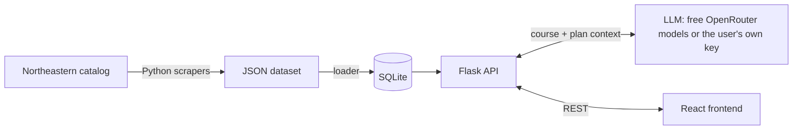

<div align="center">

# NU Insights: AI Course Advisor

**Plain-English, student-focused breakdowns of every Northeastern University course.**


**Live demo: coming soon**

</div>

---

## The problem

Northeastern's course catalog tells you a course's title, credits, and a dry paragraph of description. It doesn't tell you what the class is really like, when most students take it, or why it matters for co-op. That knowledge usually comes from asking upperclassmen.

## The solution

NU Insights pulls together everything the catalog knows about a course: its description, prerequisite tree, corequisites, NUpath attributes, and where it sits in the official sample plans of study. It hands all of that to an LLM, which explains the course the way an upperclassman would:

- **What it covers**: a 2–3 sentence summary in plain English
- **Who should take it**: the typical year and semester, taken from real sample plans rather than guessed
- **Skills you'll leave with**
- **Career and co-op relevance**

## Features

- 🔎 **Search 5,900+ courses** across 160 departments by code (`cs`, `cs 3000`) or by title
- 📋 **Course detail view** with credits, prerequisite AND/OR trees, corequisites, NUpath tags, and sample-plan placement
- 🤖 **Course breakdowns on request**: open a course and choose **Get course breakdown**, or type a code like `CS 3000`
- 🗓️ **Published sample plans of study**, when available, with catalog-year coverage tracked across undergraduate majors
- 🔑 **Bring your own API key** for OpenAI, Anthropic, Google Gemini, or OpenRouter, with a live model list
- 🧭 **Course Builder** (`#/builder`): enter completed and current courses, AP/IB/transfer credit, co-ops, skipped terms, and pinned courses, then fill the remaining terms with a checked proposal you can apply or discard

## How it works



1. **Scraping**: custom BeautifulSoup scrapers crawl the public catalog and parse each course, including turning free-text prerequisites into a nested AND/OR tree.
2. **Storage**: a loader normalizes the JSON into SQLite tables for courses, corequisites, NUpath attributes, and sample-plan entries.
3. **Prompting**: for each request, the API builds a prompt from the course's metadata and every sample plan it appears in, so the model works from facts instead of guessing.
4. **Frontend**: a React app with a scrollable landing page and a course-first workspace: a search rail, a course detail view, and a breakdown reading area that renders the model's Markdown response.

## Engineering highlights

- **Free by default.** Requests in the default mode cap the price at $0 and fall back across free models automatically. If a provider starts charging, the request fails safely instead of running up a bill.
- **Cheap with your own key.** Requests made with a user's key ask for the cheapest thinking setting the model accepts, and the model list shows the 10 newest models first.
- **Grounded output.** The system prompt tells the model to rely on the supplied plan data and to say so when there is none, rather than invent a semester.
- **Robust error handling.** Upstream failures (rate limits, timeouts, truncated or malformed responses) map to clear HTTP statuses and a consistent `{"error", "code"}` JSON envelope that the UI shows to the user.
- **Keys stay in memory.** A user's own API key lives only in the page's memory and in the single request that uses it. It is never saved, logged, or swapped for the server's key.
- **Offline test suite.** Backend tests mock the HTTP transport, so they run without an API key, network access, or a database.

## Using your own API key

The app uses free OpenRouter models by default, and those requests are capped at $0. To use a different model, open **Model settings** in the workspace header, choose **Use my API key**, pick a provider (OpenAI, Anthropic, Google Gemini, or OpenRouter), paste your key, and choose a model. The list loads by itself, with the 10 newest models first and every model after them. OpenRouter's list loads before you enter a key. You can also type any model ID.

- Your key is kept only in the page's memory, so reloading clears it. The app remembers your provider and model choice but never the key. The key passes through this app's server to the provider you chose and is never stored or logged.
- Requests made with your key are billed to your provider account, and that includes paid OpenRouter models. There's no fallback: if your key or model fails, the app shows the error instead of retrying with another model or with the server's key.
- To keep costs down, the app picks the cheapest thinking setting each model allows. Thinking is turned off where the model permits it, set to its lowest level where it can't be turned off, and left at the model's default when there's no control. Any thinking is billed but never shown; you only see the final answer.
- Loading the model list doesn't run a test generation. A listed model can still fail because of access or billing limits, and those are only checked when you request an analysis.

## Tech stack

| Layer | Tools |
| --- | --- |
| Frontend | React 19, plain CSS design tokens (`src/index.css`), Sofia Sans, react-markdown |
| Backend | Python, Flask, SQLite |
| AI | OpenRouter (free models) via the OpenAI SDK; user keys for OpenAI, Anthropic, Gemini, OpenRouter over HTTPX |
| Data | requests, BeautifulSoup |

## Project structure

```
├── advisor.py          # Flask API, prompt building, and OpenRouter integration
├── ai_providers.py     # Bring-your-own-key providers: validation, model lists, generation
├── db_loader.py        # Builds the SQLite database from data/
├── planner_rules.py    # Compiles catalog requirement rows into executable rules + reviewed profiles
├── planner.py          # Course Builder: plan validation, CP-SAT generation, AI ranking parsing
├── test_planner.py     # Offline planner tests, including the BSCS pilot
├── test_advisor.py     # Offline backend tests
├── data/               # Scraped catalog: departments, courses, sample plans
├── docs/               # Design notes (bring-your-own-key plan)
├── json_scrapers/      # Catalog scrapers
└── frontend/           # React app
```

<details>
<summary><b>Running locally</b></summary>

Requires Python 3.10+ and Node 18+. An [OpenRouter API key](https://openrouter.ai/keys) is optional. It powers the free default mode, and without it, users can still bring their own key.

```sh
python3 -m venv .venv && source .venv/bin/activate
pip install -r requirements.txt
python3 db_loader.py                         # builds courses.db from data/
echo "OPENROUTER_API_KEY=sk-or-..." > .env   # optional: free default mode
cd frontend && npm install && npm start      # API on :8000, app on :3000
```

`npm start` runs the API with whichever `python3` is on your `PATH`, so keep the virtual environment active. Run only the API with `python3 advisor.py`.

`courses.db` isn't tracked by git. The loader rebuilds it from the JSON data, including the selected plan catalog.

Run `FLASK_DEBUG=1 npm start` to turn on Flask's reloader and debugger during development. Keep it off anywhere else, because the debugger can expose request data. Serve the app over HTTPS if you host it, since user keys travel through the API.

</details>

<details>
<summary><b>Refreshing catalog data and sample plans</b></summary>

With the virtual environment active and dependencies installed:

```sh
python json_scrapers/department_scraper.py
python json_scrapers/course_scraper.py
python json_scrapers/plan_scraper.py
python db_loader.py
```

The plan scraper discovers bachelor programs from the catalog A-Z index. It retains the edition selected in the active manifest; a new dataset defaults to the live edition. Use `--catalog-year` to select another edition or `--current-catalog` to switch back to the live edition. It includes combined majors and campus variants under the undergraduate catalog; College of Professional Studies programs, minors, and graduate programs are outside this scraper's scope.

Published plans are saved to `data/plans/<catalog-year>/<program-id>.json`. Each file preserves source URL, degree, campus, college, plan variants, original entry text, credits, course bundles, alternatives, electives, co-op periods, and notes. Only definite course entries enter the semester's `courses` list; alternatives and choice groups remain structured entries and notes, so the advisor does not treat every option as mandatory. Course bundles retain their combined credit value rather than assigning those credits to each course.

`data/plan_catalog.json` selects the active edition and lists every checked program as `available` or `no_published_plan`. The loader reads only plan files declared in this manifest. Existing unversioned sample files remain on disk for reference, but are excluded once a catalog manifest is present. Without a manifest, the loader retains support for the original unversioned files.

The October 13, 2026 run checked all 395 discovered undergraduate bachelor program variants in the **2026–2027** catalog. None published sample-plan grids, so this edition contains **zero schedules**. Missing plans are recorded explicitly; the scraper does not invent schedules from degree requirements or silently import older plans. Run it again if Northeastern publishes plans later.

The active dataset uses **2025–2026 historical sample plans**, as explicitly selected. Course details label their catalog year, degree, and campus; AI prompts identify them as historical context rather than current requirements. The current course-description dataset remains 2026–2027. Programs without published plans and courses without a definite placement have distinct messages.

With a major selected, course details and AI breakdowns use only that major's historical placements. **My major** browsing uses current published requirement rows, including both sides of “or” choices such as ENGW 3302 or ENGW 3315. Courses appear under their catalog section and subsection headings. Each alternative is a clickable course row; “or” choices share an outline with “or” separators, and “and” bundles stay together. Search keeps whole matching choices visible. Subject/level elective ranges are not expanded, and selectable concentration/curriculum blocks appear under **My concentrations**. Programs without collected current requirements retain a clearly labeled historical-plan fallback. Numbered transfer-track semesters remain ordinal labels without guessed calendar years.

To populate or refresh the archived edition:

```sh
python json_scrapers/plan_scraper.py --catalog-year 2025-2026
python db_loader.py
```

Use `--output-dir /path/to/data` for a separate dataset and `--delay 0.25` to adjust the pause between requests. Requests use timeouts and retries. A failed fetch, unexpected redirect, wrong edition, or unsupported plan section produces a nonzero exit code and leaves the active manifest unchanged. `data/plan_scrape_report.json` records the latest attempt, including any failures.

</details>

<details>
<summary><b>Scraping major requirements</b></summary>

The requirements scraper collects the **current live undergraduate catalog** independently of sample plans. It covers bachelor programs (including combined majors and campus variants), published concentration pages, universitywide requirements, and all general-education tabs, including NUpath and BA language requirements. CPS, minors, and graduate programs are outside its scope.

```sh
python json_scrapers/requirements_scraper.py
```

Use `--catalog-year 2026-2027` to require that exact live edition, `--output-dir /path/to/data` for a separate dataset, and `--delay 0.5` to adjust the minimum interval between requests (default: 0.25 seconds). The scraper discovers pages through the public sitemap and checks `robots.txt` before fetching each page. It does not use the excluded A-Z index or crawl archived editions. Requests have timeouts, retries, and rate-limit backoff.

Archived undergraduate requirements for **2022–2023 through 2025–2026** are stored separately in `data/catalogs/<year>/`, alongside that edition's concentrations and course descriptions. The builder combines those editions with the live **2026–2027** requirements, covering current first- through fifth-year students. Selecting a catalog year uses that year's rules, course credits, NUpath source, and concentration options; it never substitutes the current requirements for an older degree.

To import explicitly selected archive editions:

```sh
python json_scrapers/archive_requirements_scraper.py --years 2022-2023 2023-2024 2024-2025 2025-2026
```

The archive importer follows only public links inside each selected edition, paces requests, caches source HTML in `/private/tmp/nu-catalog-imports`, and publishes a year only after its extraction completes. Pages with no published program requirements are recorded as coverage gaps. These snapshots do not replace live browsing data and require no database rebuild. Older completed courses can satisfy their original requirements; courses absent from the current teaching catalog require an approved current equivalent before future scheduling. Archived rules are labeled as extracted unless their exact content has been reviewed.

Each successful refresh creates an immutable snapshot:

```text
data/requirements/<catalog-year>/<generation>/<document-id>.json
data/requirements_catalog.json
data/requirements_scrape_report.json
```

Read only files listed in `requirements_catalog.json`; older snapshot directories can remain on disk. Program IDs match the existing plan scraper for the same source URL. Each document stores its catalog year, title, source URL, program metadata where applicable, referenced course codes, linked requirement documents, section hierarchy, original requirement text, and overview text (which can contain additional program policies).

Course tables preserve ordered rows, section headers, indentation, instruction counts, credit ranges, footnote references, subject/level elective filters, exclusions, and original wording. Unambiguous course expressions retain AND/OR structure; consecutive `or` rows share an alternative-group identifier. Lecture/lab credits stay attached to the bundle rather than being assigned to every course. Prose that mentions a course is not converted into a required course. Unsupported tables are preserved with their HTML and flagged for review.

This dataset is **structured source extraction, not a validated degree-audit rule set**. A course row may be an elective option or belong to a concentration; it is not automatically mandatory. Interpret it with the surrounding headings, instructions, alternatives, and indentation. Conditional rules, approvals, minimum grades, overlap restrictions, and other complex wording remain in source text and review-marked entries. Every document explicitly sets `semantics_validated: false`.

Links to collected requirement documents resolve to document IDs, including catalog links with surrounding whitespace or `index.html` aliases. Unresolved concentration links remain visible in each document and the manifest. When `--output-dir` contains `courses/*.json`, the scraper also reports course references missing from that local dataset; it retains the catalog's codes and does not guess replacements. Counts of selections (which may be bundles or experiences) are distinguished from explicit counts of courses.

The October 13, 2026 dataset inspected all 746 current undergraduate sitemap pages and collected **395 bachelor program variants, 22 concentration pages, and 2 shared requirement documents** from the 2026–2027 edition, with zero fetch or parsing errors. Six referenced course codes were absent from the existing local course dataset. One Family Business concentration link did not resolve to a collected requirements document (the public URL redirects to the concentration index); these discrepancies are recorded for review.

`requirements_scrape_report.json` records coverage and failures from the latest run. A fetch or parsing failure returns a nonzero exit code and leaves the active manifest and its snapshot unchanged. New files are written into a separate generation, then the requirements manifest is published. A derived concentration export is published afterward; the loader derives major and concentration course indexes from the selected requirements snapshot, so a stale export cannot change app behavior. Requirements remain source extraction rather than a validated degree audit. Major browsing uses explicit core requirement rows; selected concentration requirements are supplied to the API and AI prompt.

Run the offline scraper tests with:

```sh
python -m unittest -v test_requirements_scraper
```

### Course Builder

Open **Course Builder** from course browsing once a major is selected. Plans live only in this browser (one draft per major, requirements catalog year, and concentration choice), with JSON export/import and a print view. API keys are never saved or exported.

- **Timeline:** four academic years by default (fall → spring → Summer 1/Session A → Summer 2/Session B); add or remove terms and years, mark terms off, fully fixed, or co-op (one experience spanning consecutive terms). Shortening a plan never discards entries without asking.
- **Catalog and concentrations:** choose the requirements catalog on your degree audit, from 2022–2023 through 2026–2027. Timeline settings can switch catalog years and offer the concentration choices published for that edition. Changing either preserves history and pinned courses, clears unpinned suggestions, and rechecks the selected year's rules.
- **Adding courses:** each term lists courses its year and semester commonly hold in your major's sample plans (lecture + lab add together; sample plans are 2025–26 history, so retired codes show but can't be added). Type codes or names ("fundies 1, discrete math"): codes resolve directly, names are matched by the AI against your program's sample-plan and requirement courses plus title matches, and you tick which guesses to add. Title search updates as you type.
- **Retired courses:** an older catalog's rules stay as published, past records keep their archived credits and metadata, and future courses use current prerequisites, credits, and attributes. `data/course_replacements.json` lists documented replacements (current lecture + lab for a retired bundle), each with explicit program, campus, catalog-year, and effective-term scope plus pinned evidence. Only `verified` records count automatically: the current bundle joins the same choice slot as the exact original bundle, keeps its own code, credits, NUpath attributes, and pool eligibility, and the report says, for example, "CS 3100 + CS 3101 fulfill the CS 3500 + CS 3501 requirement" with its source. Future terms then offer that bundle in place of a retired sample-plan bundle. `candidate` records only name the documented successor next to the unmet requirement; count it with **Counts as another course?** and approval details. Registry changes change the dataset fingerprint; a missing registry applies no replacements.
- **Check my plan** (no AI): prerequisites in chronological order (minimum grades and "may be taken concurrently" when the course data records them), corequisites in the same term, exact credit choices, term limits, repeats, AWD timing, and requirement progress. A course counts toward one major/concentration rule; NUpath allows a course to meet two of the first eight competencies, and transfer credit at most five of them.
- **Fill remaining courses:** OR-Tools CP-SAT places courses only into open future terms. Completed, current, pinned, fixed, off, and co-op terms are constants. Elective pools become "choose a course" placeholders unless the AI ranked a specific option. The AI only ranks server-supplied course codes by your interests, and only when there are electives to rank and you entered interests. Ranking is optional: if the response is malformed, cut off, refused, rate-limited, or times out, the same request returns a deterministic proposal with a short note (one AI call, never retried). Key, billing, access, and model problems stay errors with **Fill without AI**. Any unknown code discards the whole ranking; safe formatting (a code fence, a bare array, code case and spacing, duplicates, more than 25 rows) is normalized locally. Models documented to support JSON-schema output get one (OpenAI GPT-4o+/o3+, Claude 4.5+, Gemini 1.5+, OpenRouter models whose catalog lists structured outputs); others, and the default route through `openrouter/free`, get the same JSON contract in the prompt. Every proposal is re-checked by the validator, shown as a diff, and applied only if your plan hasn't changed since.
- **Honest coverage:** results say "all modeled requirements covered", never "cleared to graduate". Rules the planner can't evaluate (GPA, "hours in the major", approvals, most prose notes) are listed under **Needs review** with their source text. Sample plans are 2025–26 timing hints only, and term offerings are unverified.

**Supported coverage (October 13, 2026):**

| Scope | Status |
| --- | --- |
| Computer Science, BSCS (Boston) + Artificial Intelligence concentration, 2026–27 | Rules **reviewed** against the catalog (pilot). Open items: 72 hours in the major, GPA, WI/capstone "in the major". |
| NUpath and Universitywide requirements, 2026–27 | Reviewed |
| All other 2026–27 programs and concentrations | Rules **extracted automatically, not reviewed**; generation works but every result is labeled as needing review. Ambiguous rows become review items instead of guesses. |
| Requirements catalogs 2022–23 through 2025–26 | Archived rules, concentrations, and course descriptions loaded. Rules remain labeled as extracted unless their exact content has been reviewed. Pages without published requirements are recorded as coverage gaps. |
| Intro-sequence replacements (CS 2000/2100/3100 + labs for CS 2500/2510/3500 + labs), BSCS Boston 2022–23 through 2024–25 | **Candidates only.** Khoury publishes the fall 2025 title replacements, but no source says they fulfill older degree catalogs or maps the labs. |
| CPS, minors, double majors, graduate programs | Not supported |

Reviews are pinned to a fingerprint of each source document in `planner_rules.py`; a catalog change automatically drops that program back to "not reviewed". The current `data/courses` snapshot predates raw prerequisite text, minimum grades, and exact credit options; re-run `json_scrapers/course_scraper.py` and `db_loader.py` to record them (until then, variable-credit courses are flagged as unverified). Rebuild `courses.db` with `python3 db_loader.py` after pulling this change; the builder needs the new planning tables.

### Concentrations

Choose a major, then its concentration choices. The picker follows that program's campus-specific catalog list and retains the published selection policy, including required or optional choices, second-concentration restrictions, and electives/no-concentration alternatives. Some named degrees already include a fixed concentration. Requirements can be expanded in place and link back to the catalog.

**My concentrations** browses explicit course rows in selected requirement blocks, including all “or” alternatives and elective options. Both views preserve catalog section headings and selection instructions. Outlined “or” groups contain individually clickable courses, with “and” bundles intact within each alternative. Neither view marks every listed course as mandatory or expands subject/level elective ranges. Course details distinguish an explicit course mention from possible range-based electives or approved substitutions. AI breakdowns receive the selected concentration blocks and policy text, with their catalog year, independently of historical sample-plan timing. This is not a validated degree audit.

The current 2026–2027 snapshot resolves **739 program-specific concentration/curriculum options across 99 program variants**. These include repeated concentrations offered by multiple majors and electives alternatives, not 739 unique concentrations. The stale Family Business reference remains reported separately. Inline requirements use anchor IDs when available; older snapshots fall back only to a unique matching heading.

The requirements scraper exports `data/concentration_catalog.json` automatically. To rebuild that export from already collected requirements without fetching the website:

```bash
python json_scrapers/concentration_scraper.py
python db_loader.py
```

The export stores shared requirement blocks once and keeps eligibility per program. The loader reads only the active requirements manifest, loads concentration tables, and maps archived plan URLs to their current catalog paths so existing major selections and placements retain their identity. Selections persist locally, reset when the major changes, and are revalidated against the loaded catalog year. Changing concentrations during AI generation affects only later breakdowns.

API: `GET /api/programs/<id>/concentrations`, `GET /api/programs/<id>/courses?concentrations=<id>,<id>&q=&offset=`, and optional `concentrations: [<id>, ...]` alongside `major` in `POST /api/analyze`. Cross-major, duplicate, malformed, and disallowed selections are rejected before AI requests.

</details>

<details>
<summary><b>Configuration (<code>.env</code>, free default mode only)</b></summary>

| Variable | Default | Notes |
| --- | --- | --- |
| `OPENROUTER_API_KEY` | none | Needed for the free default mode; search, course details, and user keys work without it |
| `OPENROUTER_MODEL` | `google/gemma-4-31b-it:free` | Primary model, tried first on every request |
| `OPENROUTER_FALLBACK_MODELS` | `openrouter/free` | Comma-separated; leave it empty to turn off fallback |
| `OPENROUTER_REASONING_ENABLED` | `false` | `true` or `false`; if `true`, raise max tokens to about 4096 |
| `OPENROUTER_MAX_TOKENS` | `2048` | |
| `OPENROUTER_TIMEOUT_SECONDS` | `35` | SDK network timeout, not a total deadline |

Requests made with a user's key don't use these settings. Their limits are fixed in `ai_providers.py`: 16,000 output tokens, which leaves room for thinking, a 120-second timeout, and 15 seconds for model lists.

Free OpenRouter models are usually limited to 20 requests per minute and 50 per day, or 1,000 per day after you buy credits. The limit covers the whole account, and failed requests may count toward it. Without a server key, `/api/analyze` in the default mode returns 503 `ai_not_configured`.

</details>

<details>
<summary><b>API</b></summary>

| Endpoint | Purpose |
| --- | --- |
| `GET /api/search?q=` | Search by department, course code, or title |
| `GET /api/course/<dept>/<number>` | Course details, prerequisites, and sample-plan placement for every major (the UI filters to the selected major) |
| `GET /api/programs` | Every catalog program: `[{"id", "label", "major_name", "degree", "campus", "college", "status"}]`, A-Z by label. `id` matches `plan_entries.major`; `label` is unique (repeated titles add the college); `status` is `available` or `no_published_plan`. Empty if the database predates the `programs` table. |
| `GET /api/programs/<id>/courses?q=&offset=` | Explicit current major requirement rows, including alternatives, 20 per page: `{"program", "requirement_dataset", "results", "total"}`. Each flat result includes `requirement_contexts` with choice expressions and selection instructions. Add `view=sections` for ordered `requirement_sections` containing clickable course summaries and preserved AND/OR trees. Section browsing has no pagination; search retains whole matching choices so alternatives are never split or hidden. Add `concentrations=<id>,<id>` for selected concentration requirements and `concentration_dataset` provenance instead. Older datasets without current requirements return historical `plan_dataset` context. Filters run before pagination and each course appears once. Unknown id: 404 `unknown_major`; bad offset: 400. |
| `POST /api/analyze` | `{"dept": "cs", "number": "3000"}` uses the free default. Add `"ai": {"mode": "custom", "provider": "openai", "api_key": "...", "model": "..."}` to use your own key. The provider is `openai`, `anthropic`, `gemini`, or `openrouter`. Add `"major": "<program id>"` to tailor the breakdown to that major; the prompt then carries the canonical label and only that major's placements. An unknown or non-string major returns 400 `unknown_major`; omit the field for no major. |
| `POST /api/ai/models` | `{"provider", "api_key"}` returns `{"top": [...10 newest], "models": [...all, A-Z]}`. OpenRouter needs only `{"provider": "openrouter"}`. |
| `GET /api/health` | Status and whether the free default mode is configured |
| `GET /api/exams/catalog` | Published AP/IB admission policies and exam subjects. Optional `policy_year` and `version` restore a saved snapshot. |
| `POST /api/exams/resolve` | Resolve `{exams: [{id, exam_id, score, level, policy_year, version, state}]}` into sourced NU equivalents. `state` is `estimated` or `awarded`; IB `level` is `HL` or `SL`. Rejects invalid scores, duplicate exams, conflicting policy versions, and awards over 32 credits. |

Errors use `{"error": "...", "code": "..."}`. POST responses are sent with `Cache-Control: no-store`.

</details>

<details>
<summary><b>AP/IB exam credit</b></summary>

AP/IB entry is available under **Credit before enrollment → Add AP / IB credit**. Select the admission policy year, exam, score, and IB level, then preview the published equivalents. Save an estimate or record credit already awarded by Northeastern. Estimates stay visible but do not satisfy prerequisites or degree requirements. Awarded bundles retain their component credits and published NUpath attributes; shared equivalents are counted once. Existing course-code entry remains available.

The checked-in exam dataset covers **2026–2027**. Other admission years require a matching published snapshot; the app never assumes another year's policy applies. Each saved exam pins its policy version, independent of the requirements catalog year. These records survive local save, import/export, concentration changes, and applied planner proposals.

Refresh AP/IB policy data with:

```sh
python json_scrapers/exam_scraper.py
```

The scraper discovers the linked public charts, respects robots.txt, and extracts their tables with `pdfplumber`. It preserves raw rows, source pages, PDF hashes, and collection dates in `data/exams/<policy-year>/<version>.json`. It refuses ambiguous credit splits or changed score/cap policies before updating `data/exams/catalog.json`. Old snapshots remain available; no database rebuild is needed.

</details>

<details>
<summary><b>Tests</b></summary>

```sh
python3 -m unittest -v                                         # backend: offline, no key, network, or database
cd frontend && CI=true npm test -- --watchAll=false && npm run build
```

</details>

---

<sub>Not affiliated with or endorsed by Northeastern University. Course data comes from the public [Northeastern course catalog](https://catalog.northeastern.edu/). AI output can be wrong, so confirm with your academic advisor before registering.</sub>
